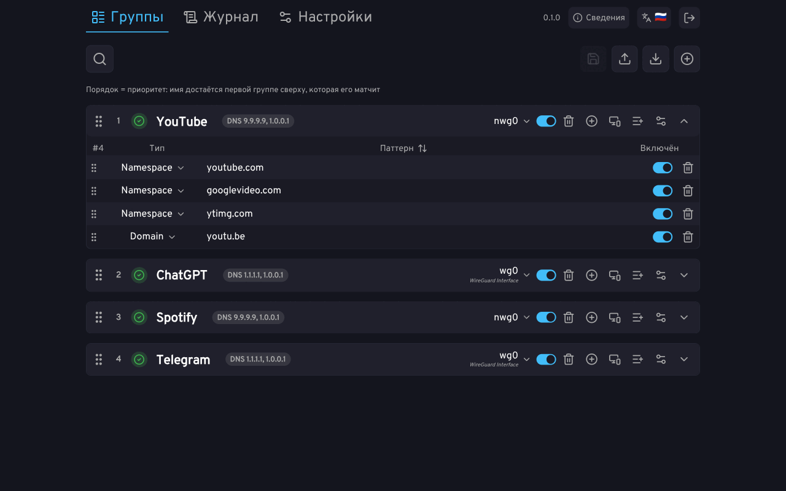
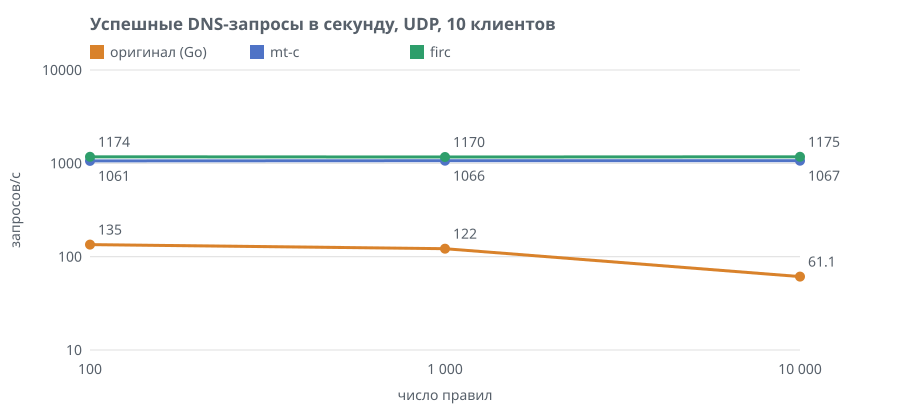
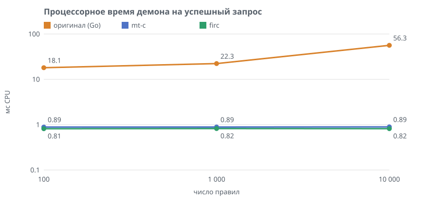
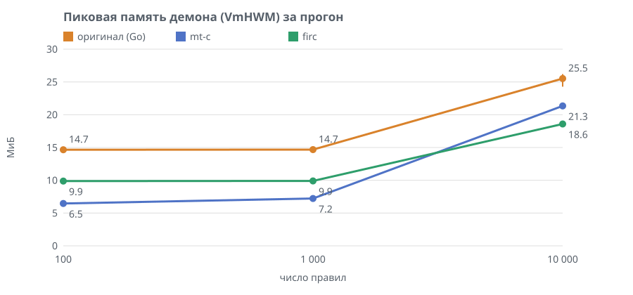

<p align="center">
  
</p>

<p align="center">
  <strong>Маршрутизация по доменам, а не по адресам.</strong>
  <br/>
  <sub>Entware / Keenetic · aarch64, mipsel, mips</sub>
  <br/>
  <a href="https://firc.hoaxisr.ru"><strong>Документация: firc.hoaxisr.ru</strong></a>
</p>

<p align="center">
  <a href="#как-это-работает">Как это работает</a> ·
  <a href="#установка">Установка</a> ·
  <a href="#типы-правил">Типы правил</a> ·
  <a href="#производительность">Производительность</a> ·
  <a href="#честное-сравнение">Сравнение</a> ·
  <a href="#ограничения">Ограничения</a> ·
  <a href="docs/swagger.yaml">HTTP API</a>
</p>

**firc** — утилита для точечной маршрутизации трафика по доменным именам на роутерах Keenetic: заворачивает нужные домены в нужный интерфейс (VPN, туннель, второй провайдер), не трогая остальной трафик. Ставится пакетом Entware поверх прошивки, работает через промежуточный DNS-прокси без отключения основного резолвера и настраивается из веб-интерфейса.

firc — продолжение форка [MagiTrickle](https://magitrickle.dev), переписанного [dan0102dan](https://github.com/dan0102dan) на C. Маршрутизация устроена принципиально иначе; общим с исходным проектом сейчас остаётся в основном дизайн веб-интерфейса.

<p align="center">
  
</p>

## Как это работает

Маршрутизация по адресам из DNS-ответа не умеет разделить два домена на одном адресе CDN: адрес у Cloudflare общий на тысячи сайтов, и в туннель уезжает либо лишнее, либо ничего.

firc перехватывает DNS-запросы клиентов. Домену, который подходит под правила группы, он **выдаёт собственный адрес** из приватного пула и отдаёт клиенту его вместо настоящего. Правило DNAT в ядре подменяет этот адрес обратно на настоящий, а метка пакета уводит соединение в интерфейс группы. Ключом маршрутизации становится домен, а не адрес CDN, за которым он живёт.

## Возможности

- **Маршрутизация по домену, а не по адресу.** Каждый домен из правил получает свой адрес из приватного пула, поэтому домены на общем адресе CDN не мешают друг другу.
- **Правила под задачу:** точный домен, домен с поддоменами, маски `*`/`?`, регулярные выражения, подсети IPv4 и IPv6. Для подсети можно указать протокол (TCP/UDP) и список портов: тогда в интерфейс уходит только этот трафик.
- **Списки правил в группе:** обычный текстовый список или rule-set sing-box по ссылке: исходный JSON или скомпилированный `.srs`, с автообновлением по расписанию. Списки на сотни тысяч правил листаются и ищутся постранично.
- **DNS через интерфейс группы:** запросы на резолв доменов группы уходят через тот же интерфейс, через который маршрутизируется трафик этой группы. Так CDN отдаёт адреса для региона этого интерфейса.
- **Выбор устройств:** группа работает для всех устройств или только для выбранных — по политикам доступа Keenetic и по отдельным устройствам (MAC).
- **Журнал в веб-интерфейсе:** события демона, DNS-ответы с указанием выданного адреса и группы, захват трафика, который идёт мимо firc (обход через DoH или жёстко прописанный IP).
- **Настройки в веб-интерфейсе:** разделены на применяемые сразу и требующие перезапуска; перезапуск демона виден по шагам, а при ошибке объясняется, что пошло не так.
- **Fail-closed:** если интерфейс группы недоступен, её трафик не уходит мимо туннеля в открытую сеть.
- **Самовосстановление:** после того как прошивка перезаписывает таблицы netfilter, правила firc возвращаются примерно за 0,3 с; привязки доменов переживают перезапуск демона.

## Установка

Проще всего — из репозитория [repo.hoaxisr.ru](https://repo.hoaxisr.ru): подключите его для своей архитектуры (`aarch64-k3.10` — Keenetic на ARM, `mipsel-k3.4` — MT7621/MT7628, `mips-k3.4` — MIPS big-endian; в примере mipsel) и поставьте пакет:

```shell
grep -qs repo.hoaxisr.ru /opt/etc/opkg.conf /opt/etc/opkg/*.conf ||
  echo "src/gz hoaxisr http://repo.hoaxisr.ru/mipsel-k3.4" > /opt/etc/opkg/hoaxisr.conf
opkg update && opkg install firc
```

Первая строка добавляет репозиторий, только если его ещё нет ни в `/opt/etc/opkg.conf`, ни в `/opt/etc/opkg/*.conf` (например, он уже подключён для AWG Manager): два источника с одним именем opkg не нужны. Архитектуру роутера покажет `opkg print-architecture` (`mipsel-3.4_kn` → `mipsel-k3.4`).

Пакеты также публикуются на странице [Releases](https://github.com/hoaxisr/firc/releases). Вариантов три — по архитектуре:

| Роутер | Пакет |
|---|---|
| Keenetic, aarch64 | `firc_<версия>-<ревизия>_entware_aarch64-3.10_kn.ipk` |
| Keenetic, mipsel | `firc_<версия>-<ревизия>_entware_mipsel-3.4_kn.ipk` |
| Keenetic, mips (big-endian) | `firc_<версия>-<ревизия>_entware_mips-3.4_kn.ipk` |

Все пакеты — сборки под Keenetic (`_kn`): разбор имён интерфейсов через RCI, хук `netfilter.d`, зависимость от `socat`.

```shell
curl -L -O https://github.com/hoaxisr/firc/releases/download/<версия>/firc_<версия>-<ревизия>_entware_<таргет>.ipk
opkg install ./firc_<версия>-<ревизия>_entware_<таргет>.ipk
```

`-L` обязателен: GitHub отдаёт файл через перенаправление, и без него `curl` сохранит пустой файл, а `opkg` ответит `Malformed package file`.

Пакет запускает firc сам, при обновлении — перезапускает. Обновление — тем же способом; из репозитория — `opkg update && opkg upgrade firc`.

Нужен роутер Keenetic с Entware, aarch64, mipsel или mips. Памяти демону нужно немного: около 5 МБ без правил и около 21 МБ при 300 000 правил в списках; во время синхронизации большого списка — до 48 МБ (замеры ниже). OpenWrt не поддерживается. Сборка из исходников описана в [BUILDING.md](BUILDING.md).

Место на накопителе Entware: сам firc — около 2,4 МБ (пакет — около 1 МБ). Зависимости, которых нет в чистом Entware, — ещё 7,5 МБ на mipsel и mips и 8,8 МБ на aarch64; больше всего из них занимает `libopenssl` (5–6,5 МБ), её тянет `libcurl`. Итого с нуля — около 10 МБ на mipsel и mips и около 11 МБ на aarch64; если `curl` и OpenSSL уже стоят, firc добавит около 2,5 МБ. Самообновлению нужен ещё около 1 МБ под скачанный пакет.

## Типы правил

- **domain** — точный домен, без поддоменов: `sub.example.com` ловит только `sub.example.com`.
- **namespace** — домен и все его поддомены: `example.com` ловит `example.com`, `sub.example.com`, `a.sub.example.com`.
- **wildcard** — шаблон с `*` (любые символы) и `?` (ровно один символ): `*example.com` ловит и `example.com`, и `anotherexample.com`.
- **regex** — регулярное выражение [PCRE2](https://www.pcre.org/), для опытных: `^[a-z]*example\.com$`.
- **subnet** — подсеть IPv4 в нотации CIDR (`203.0.113.0/24`), по желанию только для заданного протокола и портов.
- **subnet6** — подсеть IPv6 в нотации CIDR (`2001:db8::/32`), с тем же уточнением по протоколу и портам.

## Производительность

| Метрика | Значение | Как мерили |
|---|---|---|
| RSS без правил | 5,2 МБ | VmRSS через 15 с после старта и одного DNS-запроса |
| RSS, 1 000 правил в списке | 5,4 МБ | `run_sub_cost.sh`, VmRSS после синхронизации списка |
| RSS, 100 000 правил | 11,9 МБ (пик 19,7 МБ во время синхронизации) | `run_sub_cost.sh`, VmRSS / VmHWM |
| RSS, 300 000 правил | 21,1 МБ (пик 48,0 МБ во время синхронизации) | `run_sub_cost.sh`, VmRSS / VmHWM |
| Синхронизация списка | 100 000 правил — 4,6 с; 300 000 — 14,8 с | `run_sub_cost.sh`: от POST синхронизации до события `done`, список отдаётся с самого роутера |
| DNS, домен без правил | p50 2,0 мс, p99 3,2 мс | `dnsload`, 1 клиент, 10 с, UDP, 1 000 имён, апстрим — `dnsstub` |
| DNS, домен под правилом, повторный запрос | p50 2,1 мс, p99 3,6 мс | то же, имя уже получило свой адрес; резолв группы через туннель выключен (по умолчанию к ответу добавляется задержка туннеля) |
| DNS, первый запрос нового домена под правилом | ≈0,26 с (p50 262 мс, p99 267 мс) | то же; ответ ждёт, пока в ядро запишется его правило DNAT |
| Пропускная способность DNS при p99 < 50 мс | ≈1 000 запросов/с (без правил 1 067 при p99 38 мс; под правилом 996 при p99 40 мс) | `dnsload`, перебор 1–100 параллельных клиентов, этот уровень при 20 |
| Восстановление правил netfilter после перезаписи таблицы прошивкой | медиана 0,31 с, максимум 0,33 с (20 повторов) | все правила firc удалены из `nat` одним `iptables-restore`, вызван хук `netfilter.d`; время до возврата всех правил; конфигурация с 5 правилами DNAT |
| Перезапуск до ответа API | медиана 2,67 с (5 повторов) | `S99firc restart`, опрос сокета API каждые 10 мс; включая остановку |

Keenetic KN-1810 (MT7621, 254 МБ ОЗУ), KeeneticOS 5.01.C.6.0-1, firc 0.1.0 (предрелизная сборка), 5 октября 2026; нагрузка, заглушка и демон на одном 2-ядерном CPU; aarch64 не мерили.

Повторить замеры: скрипты и генераторы нагрузки — в [tools/bench/](tools/bench/README.md).

## Честное сравнение

firc, [mt-c](https://github.com/dan0102dan/mt-c) и оригинальный MagiTrickle на Go под одной нагрузкой, на одном роутере и **методикой mt-c**: их харнесс и генератор `dnsload`, к которым добавлен третий демон. Все три работают **полным путём**, как у пользователя: с включённым netfilter, группа направлена в один и тот же интерфейс. Keenetic KN-1810 (MT7621), 1 000 правил, штатный DNS роутера, 10 клиентов без пауз; медианы трёх прогонов по 20 с.

| Метрика | MagiTrickle 0.8.2 (Go) | mt-c 0.8.5.4 | firc 0.5.3 |
|:---|---:|---:|---:|
| Успешные запросы UDP, шт./с | 122 | 1 066 | **1 170** |
| Успешные запросы TCP, шт./с | 99 | 305 | **346** |
| Задержка p95, UDP, мс | 168 | 11.8 | **11.2** |
| CPU демона на запрос, UDP, мс | 22.3 | 0.89 | **0.82** |
| CPU демона под нагрузкой, % | 264 | 95 | 96 |
| Память в простое, МиБ | 13.3 | **7.2** | 7.8 |
| Пик памяти за прогон, МиБ | 14.7 | **7.2** | 9.9 |
| 20 запросов/с: p95, мс | 22.9 | 60.0 | **2.6** |
| От запуска до первого ответа, мс | 1 747 | **399** | 1 161 |
| Пакет `.ipk` / после установки, МБ | 2.42 / 2.73 | **0.37 / 1.04** | 1.36 / 3.23 |

<p align="center">
  
</p>
<p align="center">
  
</p>
<p align="center">
  
</p>

Что важно знать о цифрах:

- **Нагрузка — только DNS.** У всех трёх стояли их правила iptables, ip rule и маршруты (это проверялось после каждого прогона), но трафик через них не шёл: цена прохода пакетов не измерялась.
- **Память.** На 100–1 000 правил легче mt-c, на 10 000 — firc (13.4 против 14.4 МиБ в простое).
- **Старт.** firc начинает отвечать через ~1 с даже на 100 правилах, mt-c — через 0,3 с; на 10 000 правил firc — 2 с.
- **Пакет firc больше**, потому что в нём встроенный VLESS-клиент `tunvless` (1,1 МБ).
- У mt-c на ровной нагрузке в двух прогонах из трёх p95 около 60 мс; в третьем — 3 мс.
- Демоны на C упираются в одно ядро, генератор работает на том же CPU; прямой запрос к штатному DNS даёт 1 501 запрос/с. Сравнивать можно только внутри одного прогона.

Полные таблицы, версии и SHA-256 пакетов, проверка состояния netfilter, отклонения от методики и сырые данные — [docs/benchmarks/2026-11-03](docs/benchmarks/2026-11-03/README.md). Прошлый замер, где mt-c и оригинал работали без iptables, — [docs/benchmarks/2026-10-17](docs/benchmarks/2026-10-17/README.md).

## Ограничения

- `traceroute`/`tracert` до домена, который маршрутизирует firc, показывает выданный ему адрес на каждом хопе: NAT ядра переписывает и ICMP-ошибки, которые возвращаются с промежуточных узлов.
- Обратный запрос (PTR) к выданному адресу возвращает домен, которому этот адрес выдан.

Жёсткие лимиты демона (размер пула, число имён, групп) и что происходит при их достижении — в [docs/limits.md](docs/limits.md).

## Ссылки

- [BUILDING.md](BUILDING.md) — сборка из исходников
- [CONTRIBUTING.md](CONTRIBUTING.md) — как предложить изменения
- [docs/limits.md](docs/limits.md) — лимиты демона
- [docs/swagger.yaml](docs/swagger.yaml) — HTTP API
- [Баг-трекер](https://github.com/hoaxisr/firc/issues)

## Лицензия

GPL-3.0-or-later, см. [LICENSE](LICENSE).
